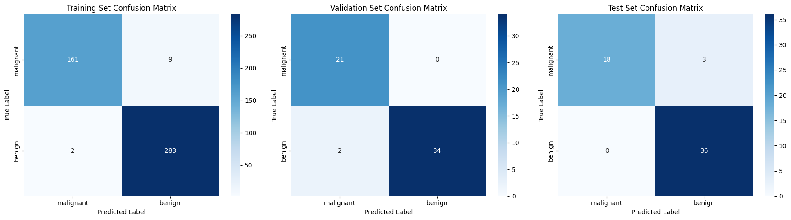
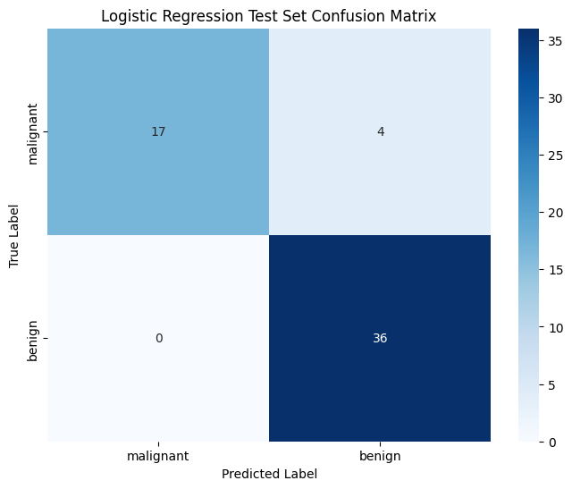
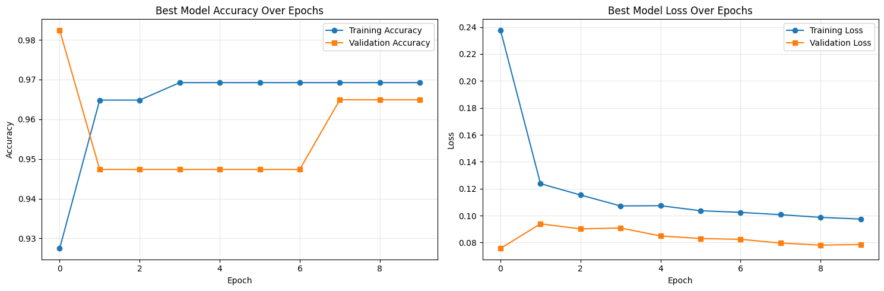

# Breast Cancer Classification with Neural Networks

A portfolio project comparing a feedforward neural network with logistic regression on the Wisconsin Diagnostic Breast Cancer dataset, with attention to malignant-class recall and model limitations.

## Data and approach

- Built-in scikit-learn dataset: 569 samples, 30 features; 212 malignant and 357 benign.
- Stratified train/validation/test split: 455 / 57 / 57 samples, using seeds 77 and 2025.
- Training-only StandardScaler and ANOVA SelectKBest selection of 10 features.
- Baseline: four hidden layers × 20 SELU units, LeCun normal initialization, Adam, binary cross-entropy, 10 epochs.
- RandomSearch: 2–6 layers, 8–64 units in steps of 8, log-sampled learning rate 0.0002–0.2; up to 8 trials, 10 epochs each.
- Recorded selected network: 3 × 64 SELU units; displayed learning rate 0.002273; sigmoid output and threshold 0.5.
- Logistic regression: L2, C=1, lbfgs, class weights {0: 0.4, 1: 0.6}, random_state=42, on the same selected features.

## Recorded results

| Test metric | Neural network | Logistic regression |
|---|---:|---:|
| Accuracy | 0.9474 | 0.9298 |
| Malignant precision | 1.0000 | 1.0000 |
| Malignant recall | 0.8571 | 0.8095 |
| Malignant F1 | 0.9231 | 0.8947 |
| Specificity for malignant detection | 1.0000 | 1.0000 |
| Missed malignant cases | 3 / 21 | 4 / 21 |

All values are from saved outputs, not a new training run. Labels are 0=malignant and 1=benign; clinical sensitivity refers to malignant-class recall. Test matrices have rows=true and columns=predicted, ordered [malignant, benign]. The network correctly classified one more case on the 57-sample test partition.

The network's training/validation/test accuracies were 0.9758 / 0.9649 / 0.9474. The baseline validation accuracy was 1.0000, compared with 0.9649 for the final tuned network; tuning did not improve this validation metric. The recorded search reloaded a prior tuner cache, which is not included.





## Run locally

Use Python 3.11 in a virtual environment:

```sh
python -m venv .venv
# Activate the environment using the command appropriate to your operating system.
python -m pip install -r requirements.txt
jupyter lab breast_cancer_ann.ipynb
```

Read the saved notebook directly on GitHub, or run its cells in order. The data loads from scikit-learn, so no separate CSV is required. TensorFlow 2.19.0, Keras 3.10.0, NumPy 2.0.2, and Keras Tuner 1.4.7 were visible in the original environment logs. Other dependency versions were not recorded. The environment has not been installed or execution-tested during repository preparation.

Re-execution trains new models and may change the outputs. Fixed seeds do not guarantee identical results across environments, and a fresh search lacks the original cached trials. A rerun saves breast_cancer_ann.keras locally; the recorded fitted model and preprocessing objects were not supplied.

## Scope and limitations

This exploratory benchmark uses one small test partition. It does not establish clinical readiness or a general advantage of neural networks. External validation, repeated evaluation, calibration assessment, and threshold selection on validation data remain future work. Hyperparameter tuning optimized validation accuracy, not malignant-class sensitivity. No confidence intervals, external cohorts, or deployment validation are reported.

## Repository contents

```text
breast-cancer-classification/
├── breast_cancer_ann.ipynb
├── README.md
├── requirements.txt
├── .gitignore
├── images/
│   ├── training-history.png
│   ├── ann-confusion-matrices.png
│   └── logistic-regression-confusion-matrix.png
└── results/
    └── recorded-test-metrics.csv
```

The figures are extracted unchanged from the saved notebook. The CSV transcribes the recorded test metrics. No new model results are claimed.
